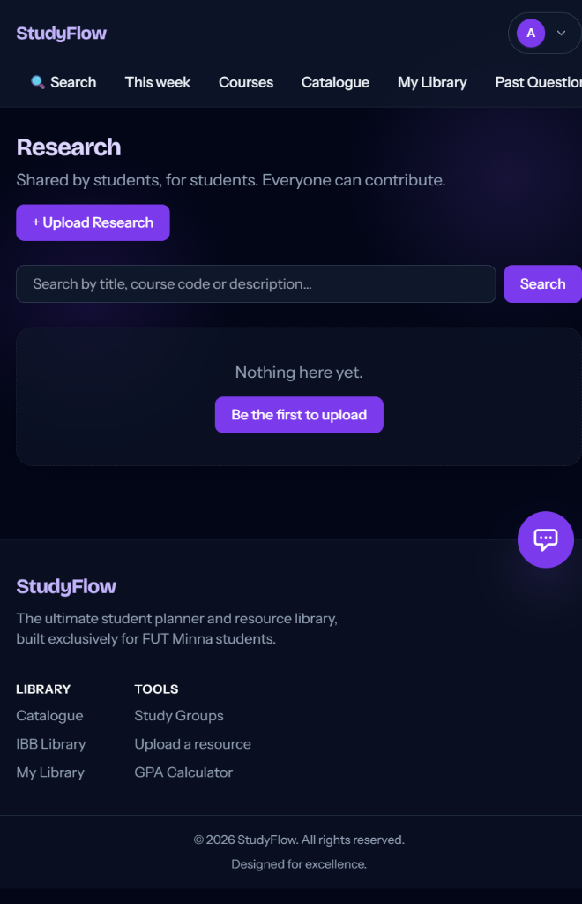
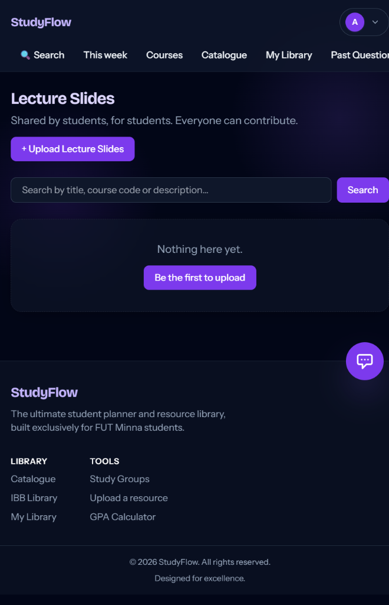

# 📚 StudyFlow

[](https://github.com/peterafolabi-dev/studyflow/actions/workflows/tests.yml)


**A study platform for university students, with a 24/7 AI study coach that renders maths properly. Built with Django, deployed on Render.**

**Live:** [studyflow-xt1x.onrender.com](https://studyflow-xt1x.onrender.com) (free tier, so the first load can take ~30 seconds to wake up)

StudyFlow combines planning, AI help, resource sharing and focus tools in one responsive app. Built for students at FUT Minna, and any student who wants to study smarter.

<p> </p>

---

## Engineering decisions

- **Uploads are judged by their bytes, not their names.** A file renamed from `.exe` to `.pdf` is rejected because the server checks its magic bytes (`%PDF-`), not just the extension or the browser's MIME type. Files are stored under a random UUID, so a crafted filename can never reach the filesystem.
- **AI output is treated as untrusted.** Model replies can contain HTML, so they're sanitised with DOMPurify before they touch the page. LaTeX is rendered with KaTeX instead of being trusted as markup.
- **AI cost and abuse are capped.** Expensive AI features (like asking questions about a PDF) have a per-user rate limit, so one user or script can't run up the API bill.
- **Two layers of validation.** The browser gives instant feedback on file type and size, and the server repeats every check, because client-side checks are a convenience, not security.
- **Deploys only after green tests.** GitHub Actions runs `manage.py check`, a missing-migrations check and all 108 tests on every push, and Render can wait for CI before going live.

---

## ✨ Features at a Glance

| Feature | Description |
|---|---|
| 🤖 AI Study Coach | Groq-powered assistant with conversation memory, LaTeX math rendering, and active recall assistance |
| 📋 Dashboard | Bento-style overview of tasks, courses, recent resources, and quick tools |
| 📚 Catalogue | Global library of books students can browse, save, and read online |
| 🏛️ IBB Library | Reserve physical books at FUT Minna's IBB Library — track loans in real time |
| 📁 Resources | Upload and download Past Questions, Notes, Theses, and Lecture Slides |
| ⏱️ Pomodoro Timer | Study Room with a focus timer, Deep Focus + Lo-Fi Spotify playlists, and session logging |
| 🃏 Flashcards | Create custom decks, flip cards with 3D animation, and quiz yourself with active recall |
| 💬 Campus Chat & Groups | Live campus chat rooms and course-based study groups with 24/7 AI Coach answers |
| 📊 GPA Calculator | 5.0 scale calculator with localStorage persistence |
| 🗓️ Timetable | Build and manage your weekly class timetable |
| 🎮 Break Room | 2048 mini-game with persistent high score for 5-minute Pomodoro breaks |
| 🔐 Google OAuth | 1-tap sign in with Google via django-allauth |
| 🌙 Dark Mode | Instant light/dark theme toggle, persisted in localStorage |
| ✨ Framer Motion | Fluid spring physics animations and micro-interactions throughout |
| 📱 Mobile & Desktop | Fully responsive layout optimized for smartphones, tablets, and laptops |

---

## 🤖 24/7 AI Study Coach

The AI assistant is powered by **Groq API** (ultra-fast LLM inference) running `openai/gpt-oss-20b`.

It is designed to:
- Answer academic questions across engineering, math, coding, and sciences
- Step into study group discussions when classmates aren't online
- Render **LaTeX math equations** using **KaTeX** ($...$ for inline, $$...$$ for display)
- Generate revision flashcards with structured question-answer pairs
- Guide students through derivations step-by-step
- Run seamlessly without requiring upfront login

---

## 🔒 File Upload Security

Resource uploads are strictly validated at **two layers**:

**Frontend (immediate feedback):**
- File extension and MIME type checked in JavaScript before submission
- Max file size enforced (default 10 MB) with clear validation errors
- Drag-and-drop zone with instant visual feedback

**Backend (authoritative):**
- Extension and MIME type validated against configurable allowlist
- **Magic bytes** inspected (e.g. `%PDF-` for PDFs) — renamed `.exe` files are blocked immediately
- A **random UUID filename** is generated server-side — client filenames are never used for storage
- Returns HTTP 400 with a clear error message on invalid files

Allowed types are configured in `.env`:
```env
ALLOWED_TYPES=PDF
# or: ALLOWED_TYPES=PDF, PNG, JPG, JPEG
MAX_UPLOAD_SIZE_MB=10
```

---

## 🛠️ Tech Stack

| Layer | Technology |
|---|---|
| Backend | Python 3.12, Django 6.1.1 |
| AI / LLM | Groq API (`openai/gpt-oss-20b`) |
| Frontend | Tailwind CSS, Framer Motion (Motion engine), Vanilla JS |
| Auth | django-allauth (Google OAuth + Email) |
| Database | SQLite (dev) / PostgreSQL (production) |
| Deployment | Render (Web Service + Managed PostgreSQL) |
| Static Files | WhiteNoise |
| PDF Generation | ReportLab |
| Math Rendering | KaTeX |
| Markdown | marked.js + DOMPurify |
| PWA | Web App Manifest + Service Worker |

### Styling assets

Tailwind utilities are compiled into `static/css/tailwind.css` and served locally. When changing utility classes in templates or app code, rebuild and commit the stylesheet with `npm ci` followed by `npm run build:css`. Render serves the committed file as part of its Python build, so it does not need Node.js.

---

## 📸 Screenshots

| Landing & Mobile Experience | Courses Hub |
|:---:|:---:|
|  |  |

| Academic Research Hub | Lecture Slides Hub |
|:---:|:---:|
|  |  |

| Theses & Papers Repository |
|:---:|
|  |

---

## 🚀 Getting Started

### Prerequisites

- Python 3.12+
- A [Groq API key](https://console.groq.com/) (free tier available)
- (Optional) Google OAuth credentials for Google sign-in

### 1. Clone the repository

```bash
git clone https://github.com/peterafolabi-dev/studyflow.git
cd studyflow
```

### 2. Create a virtual environment and install dependencies

```bash
python -m venv venv
venv\Scripts\activate   # Windows
# or: source venv/bin/activate  # Mac/Linux

pip install -r requirements.txt
```

### 3. Set up environment variables

Copy `.env.example` to `.env` and fill in your values:

```bash
cp .env.example .env
```

```env
# AI
GROQ_API_KEY=your_groq_api_key_here
MODEL_NAME=openai/gpt-oss-20b

# Upload restrictions
ALLOWED_TYPES=PDF
MAX_UPLOAD_SIZE_MB=10

# Google OAuth (optional)
GOOGLE_OAUTH_CLIENT_ID=your-oauth-client-id
GOOGLE_OAUTH_CLIENT_SECRET=your-oauth-secret
```

### 4. Run migrations and start the development server

```bash
python manage.py migrate
python manage.py runserver
```

Open [http://127.0.0.1:8000](http://127.0.0.1:8000) in your browser.

---

## ☁️ Deploying to Render

1. Push your code to GitHub.
2. Create a new **Web Service** on [Render](https://render.com) and connect your repository.
3. Set the **Build Command** to: `./build.sh`
4. Set the **Start Command** to: `gunicorn studyflow.wsgi:application`
5. Add your environment variables in the Render Dashboard:
   - `GROQ_API_KEY`
   - `SECRET_KEY`
   - `DATABASE_URL` (Render provides this automatically for PostgreSQL)
   - `ALLOWED_TYPES`, `MAX_UPLOAD_SIZE_MB`
   - Google OAuth keys (if using)
   - `EMAIL_HOST_USER` and `DEFAULT_FROM_EMAIL` (your Gmail address)
   - `EMAIL_HOST_PASSWORD` (a Google App Password, not your Gmail login password)

The Render blueprint sets Gmail SMTP to `smtp.gmail.com:587` with TLS. Set the three email values above in the Render Dashboard, then redeploy. Without a configured sender, Django may use its console backend: the reset form can report success while the email is only printed to the server logs.

---

## 📁 Project Structure

```
studyflow/
├── accounts/          # User auth, profiles, notifications
├── community/         # Study groups, thread discussions, find buddies, campus chat
├── library/           # Digital catalogue and book reading
├── planner/           # Dashboard, tasks, courses, flashcards, GPA, study room, break room
├── resources/         # File uploads (past questions, notes, etc.), IBB Library
├── studyflow/         # Django project settings and upload config
├── templates/         # All Django HTML templates
├── static/            # CSS, custom scrollbars, and PWA icons
├── screenshots/       # App screenshots for the README
├── requirements.txt
├── build.sh
└── manage.py
```

---

## 🛡️ Security Highlights

- **CSRF:** Django CSRF tokens enforced on all state-changing requests
- **XSS Prevention:** AI chat output sanitized with DOMPurify before DOM insertion
- **Upload Security:** Magic-byte file content validation + UUID safe filenames
- **OAuth 2.0:** Handled securely via django-allauth with PyJWT
- **HTTPS:** Enforced in production via Render + Django secure settings (`SECURE_SSL_REDIRECT`, `SESSION_COOKIE_SECURE`, `CSRF_COOKIE_SECURE`)

---

## 📄 License

MIT License — free to use, modify, and distribute.

---

## 🙏 Built by

A FUT Minna **Engineering** student building tools that actually help students win. ⚔️

> *"Every student who opens this app is an athlete in training, and their studies are the arena."*
